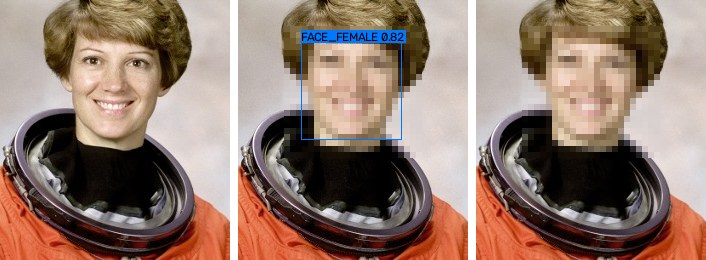

# avmosaic

Detect explicit regions in images and videos and cover them with a mosaic — from the
command line or from Python, on Windows, macOS and Linux.



*Demo uses the `faces` preset on a public-domain NASA portrait; the default preset
censors genitalia and the anus.*

**English** · [한국어](README.ko.md) · [日本語](README.ja.md)

> **Automated detection is an aid, not a guarantee.** The detector will miss regions
> (unusual angles, close-ups, occlusion, lighting) and will sometimes censor the wrong
> thing. Review every output before publishing it. You are responsible for complying
> with the laws that apply to your content. Only process material you have the right to
> process.

## Features

- Detection with the open-source [NudeNet](https://github.com/notAI-tech/NudeNet) v3
  ONNX models (`320n` ships with the package; `640m` is more accurate and downloaded on
  demand). Runs on CPU, or with CUDA / DirectML / CoreML through ONNX Runtime.
- Mosaic tiles aligned to a fixed grid so they don't shimmer between frames. The default
  tile size follows a commonly cited guideline: at least 1/100 of the image's long side
  and never under 4 px. Blur and solid fill are available too.
- Video tracking: each region is followed with optical flow, so the mosaic moves with it
  instead of smearing along its path. This covers the frames between detector runs, short
  stretches where the detector loses the region, and a few frames before it is first
  detected. Tracks end at scene cuts, and audio is kept.
- Every key parameter is a flag: classes, threshold, model, padding, tile size, shape,
  hold, codec and quality.
- Batch processing of folders. JSON reports of every detection. A `--draw-boxes` mode
  for tuning.
- Handles Unicode file names (Korean, Japanese, …), alpha channels, odd video sizes, and
  NTSC frame rates.

## Install

Python 3.10+ is required. ffmpeg is bundled through `imageio-ffmpeg`, so there is
nothing else to install. On Intel Macs, note that recent ONNX Runtime releases
ship no Intel-macOS wheels, so `pip` can only use an older ONNX Runtime, and only if
one exists for your Python version (Python 3.14 on Intel macOS has none).

```bash
git clone https://github.com/fattaillabs/avmosaic && cd avmosaic
pip install .            # or: pip install -e ".[dev]" for development
```

GPU (optional): replace `onnxruntime` with `onnxruntime-gpu` (NVIDIA CUDA) or
`onnxruntime-directml` (Windows, any GPU), then pass `--device cuda` / `--device directml`.
The default `--device auto` picks CUDA, then DirectML, then CoreML (Apple), then CPU.

## Quick start

```bash
avmosaic video.mp4                    # -> video_censored.mp4
avmosaic photo.jpg -o out.jpg
avmosaic ./scenes -o ./censored       # whole folder, structure mirrored
avmosaic video.mp4 --model 640m --detect-every 2 --hold 8
avmosaic photo.jpg --draw-boxes       # see what was detected and how confident it was
avmosaic detect video.mp4 -o detections.json   # detect only, no output media
avmosaic classes                      # list classes and presets
avmosaic models download 640m         # fetch the bigger model ahead of time
avmosaic frames sample.mp4 -o ./frames --every 2   # video -> images to label
avmosaic label ./frames                # mark where the mosaic must go, in your browser
avmosaic eval regions ./frames         # is the mosaic where you marked it?
avmosaic eval run ./NPDI -o npdi.jsonl  # benchmark on a labelled dataset (see below)
avmosaic eval summary npdi.jsonl
```

`avmosaic FILE …` is shorthand for `avmosaic censor FILE …`.

## Parameters

| Flag | Default | Meaning |
|---|---|---|
| `--classes` | `genitals` | Presets and/or class names, comma separated. Presets: `genitals` (female/male genitalia, anus), `breasts`, `buttocks`, `nudity`, `faces`, `all`. |
| `--threshold` | `0.25` | Minimum detection score. Lower it to censor more aggressively. |
| `--model` | `320n` | `320n`, `640m`, or a path to an `.onnx` file. |
| `--resolution` | model's own | Model input size (a multiple of 32). |
| `--device` | `auto` | `auto`, `cpu`, `cuda`, `tensorrt`, `directml`, `coreml`, `openvino`. |
| `--channels` | `rgb` | Channel order fed to the model (`bgr` reproduces upstream NudeNet exactly). |
| `--method` | `mosaic` | `mosaic`, `blur` or `fill`. |
| `--block-size` | `auto` | Mosaic tile: `auto`, a pixel count (`24`), or a share of the long side (`2%`). |
| `--shape` | `rect` | `rect`, or `ellipse` (still covers the whole box). |
| `--padding` | `0.15` | Grow each box by this fraction of its size on every side. |
| `--fill-color` | `black` | For `--method fill`: `black`, `white`, `#rrggbb`, `r,g,b`. |
| `--detect-every` | `1` | Video: run the detector on every Nth frame (and on every scene cut). Tracking fills the frames in between. |
| `--tracking` | `on` | Video: follow regions with optical flow. `off` censors the union of boxes found within `--hold` frames instead (simpler, but smears fast motion). |
| `--hold` | `5` | Tracking on: follow a new region back N frames before its first detection. Off: censor boxes found up to N frames before and after. |
| `--max-lost` | `15` | Tracking on: keep following a region N frames after the detector lost it. |
| `--smooth` | `2` | Tracking on: average box positions over ±N frames (the raw box is always covered too). |
| `--codec` / `--crf` / `--preset` | `libx264` / `18` / `medium` | Video encoder settings. `--ffmpeg-args "…"` passes extra encoder flags. |
| `--no-audio` | off | Drop the audio track. Audio is otherwise copied, and converted to AAC when the source codec doesn't belong in MP4 (e.g. PCM). |
| `--report FILE` | — | Write every detection (per frame for video) as JSON. |
| `--draw-boxes` | off | Draw boxes, classes and scores on the output. |
| `--progress` | `auto` | Progress: a bar in a terminal (`auto`); `always` also logs a line every 10 s when output goes to a file. |
| `-o`, `--suffix`, `-y` | — | Output file or folder, suffix used when `-o` is absent, overwrite. |

### Tuning

1. Run `avmosaic sample.mp4 --draw-boxes --report r.json` and look at the result.
2. Missed regions → lower `--threshold` (e.g. `0.15`), try `--model 640m`, raise `--hold`
   and `--padding`.
3. Too much censored → raise `--threshold`, and check which classes the report says
   were found.

## How tracking works

For each region the detector finds, avmosaic keeps a track and follows it frame by frame
with median-flow optical flow (Lucas–Kanade on a grid of points, with a forward–backward
check). The tracker is built to cover too much rather than too little:

- **Between detector runs** (`--detect-every N`): when the next detection arrives, the
  accumulated flow drift is spread back over the frames in between. Both the flow path and
  the corrected path are covered.
- **Detector misses**: the track continues on optical flow for up to `--max-lost` frames.
  If flow cannot follow (occlusion, blur, a featureless region), the box covers both "it
  stopped" and "it kept its recent speed". When the detector finds the region again within
  `--max-lost` frames, the frames of the gap are still buffered, so they also get the
  straight path between the two detections. The box also grows 1% per frame without a
  detection, up to +50%.
- **Before the first detection**: a new track is followed backwards over `--hold` frames.
- **Scene cuts**: these end all tracks and force a detection. Nothing is carried across
  the cut.

Frames are rendered with a look-ahead of `max(--max-lost, --hold, --smooth,
--detect-every − 1)` frames. At the defaults that is 15 frames, or about 100 MB at 1080p.

## Checking that the mosaic is in the right place

Whether a file is explicit is the wrong question for a censoring tool. What matters is
whether the mosaic lands where it should. A person marks that once, on a few samples, and
then it can be checked automatically every time the code or settings change:

1. `avmosaic frames sample.mp4 -o ./frames --every 2` saves a frame every 2 seconds.
2. `avmosaic label ./frames` opens a local page (served on 127.0.0.1 only). Drag a box
   around every region that must be censored. Press **C** for an image that must stay
   clean. Boxes are saved next to each image as `<name>.json`. The page starts empty;
   `--suggest` pre-fills the detector's boxes, which is faster but biases the labels
   towards what the detector already finds.
3. `avmosaic eval regions ./frames` prints a text report:
   - how much of each marked region the mosaic covers, with the worst cases listed
   - how much of the mosaic falls outside the marked regions
   - whether any clean image was censored

   It exits with status 1 if a region is covered less than 90% (`--min-coverage`) or a
   clean image loses more than 2% (`--max-false-area`). It takes the same detection and
   censoring flags as `censor`, so settings can be compared directly.
   `AVMOSAIC_SAMPLES=./frames pytest tests/test_samples.py` runs the same check as tests.

## Trying it on real footage

avmosaic does not include, host or distribute any explicit material, and its tests use
none. To try it on real footage, you can use a public research dataset such as
[The Image and video dataset for adult content detection in image and video](https://figshare.com/articles/dataset/The_Image_and_video_dataset_for_adult_content_detection_in_image_and_video/14495367?file=27771210)
(figshare).

> **18+, at your own risk.** Such datasets contain explicit adult content. Before
> downloading, read the dataset page, including its license and disclaimer. Use the data
> at your own risk and only where that is lawful. Never commit files from it to this
> repository or attach them to issues.

```bash
avmosaic "some video.mp4" --draw-boxes --report report.json   # then watch the result
avmosaic frames "some video.mp4" -o ./frames --every 2           # label + eval regions
```

## Benchmarking on NPDI / Pornography-2k

These research datasets are not public downloads. They contain copyrighted adult material,
so their maintainers share them only after a formal request and a signed responsibility
agreement:

- **NPDI** (800 videos, ~80 h; half clean, including 200 "difficult" clips such as beaches
  and wrestling): Prof. Sandra Avila, UNICAMP.
- **Pornography-2k** (2,000 videos, ~140 h): Prof. Anderson Rocha, UNICAMP.

Both have per-video labels only, without region boxes, so `avmosaic eval` measures what
those labels allow. It also accepts folders of images, where each image counts as one
sample, e.g. explicit images vs. swimwear photos as hard negatives. A file's label comes
from its path below (and including) the folder you pass: anything matching
`no[nt][-_ ]?porn` (`nonporn`, `non_porn`, `not_porn`, …) is clean, then anything matching
`porn` is explicit. Change this with `--positive` and `--negative`.

```bash
avmosaic eval run ./NPDI -o npdi-320n.jsonl --sample-fps 1             # resumable
avmosaic eval run ./NPDI -o npdi-640m.jsonl --model 640m
avmosaic eval summary npdi-320n.jsonl npdi-640m.jsonl --thresholds 0.15,0.25,0.35
```

The summary reports the following, as text only:

- the file-level AUC
- for each threshold, the share of explicit and clean videos that get censored at all,
  and the mean share of sampled frames censored (split into easy and difficult clean
  videos when the path says so)
- the clean files that scored highest, with timestamps, so you can check them for false
  alarms
- the explicit files where nothing was found

## Speed

Measured on an Apple M1 (CoreML) with a 1080p, 30 fps, 20-second clip (600 frames):

| Settings | Time | Throughput |
|---|---|---|
| default (`320n`) | 22.0 s | 27 fps |
| `--detect-every 2` | 16.1 s | 37 fps |
| `--model 640m --detect-every 3` | 75.6 s | 7.9 fps |

Detection alone takes 15.7 ms per 1080p frame for `320n` (33.1 ms on CPU) and 346 ms for
`640m` (469 ms on CPU). Re-encoding the same clip with ffmpeg alone takes 8.3 s.

Tracking added about 10% in a separate run on the same clip (31.8 s → 34.8 s). The clip
contained no regions to follow, so this is the scene-cut check. With tracking,
`--detect-every 3` keeps boxes on target and took 20.0 s.

## Python API

```python
from avmosaic import CensorOptions, VideoOptions, censor_image, censor_video, create_detector

detector = create_detector("320n", classes=["FEMALE_GENITALIA_EXPOSED", "MALE_GENITALIA_EXPOSED"],
                           threshold=0.2)
censor_image("in.jpg", "out.jpg", detector, CensorOptions(block_size="2%"))
censor_video("in.mp4", "out.mp4", detector, CensorOptions(), VideoOptions(hold=8))
```

Any object with a `detect(bgr_image) -> list[Detection]` method can replace the
detector, for example a model you trained yourself.

## Testing

```bash
pip install -e ".[dev]"
pytest                    # everything (about 10 s)
pytest -m "not model"     # skip the tests that run the real model
```

The tests use no explicit material.

- **Pipeline tests** replace the model with a colour detector that treats a synthetic
  red/black checkerboard as the region to censor. They check mosaic geometry, frame count,
  audio and duration, the frame-hold logic (a deliberately missed frame leaks with
  `hold=0` and is covered with `hold=2`), odd sizes, NTSC rates and Unicode paths.
- **Tracking tests** run the planner on in-memory frames and measure exactly how much of
  the true object box is covered in every frame. The scenarios are fast motion, 15-frame
  detector misses, curved paths with `--detect-every 6`, backfill, scene cuts, two objects
  moving in opposite directions, and forced optical-flow failure. In the fast-motion test,
  a 40 px object stays fully covered either way. Tracking censors 1.03× the object's area
  at 8 px/frame and 1.14× at 25 px/frame. `--tracking off` censors 2.70× and 5.48×.
- **Model tests** run the real NudeNet model. They check that its output matches upstream
  `nudenet` exactly in BGR mode, and use the model's *face* class on a public-domain photo
  as an end-to-end check.
- **Your own accuracy check:** put labelled images in a private folder (never commit them)
  and run `AVMOSAIC_SAMPLES=/path/to/samples pytest tests/test_samples.py -v`. See
  [tests/test_samples.py](tests/test_samples.py) for the label format.

CI runs the suite on Linux, macOS and Windows with Python 3.10, 3.12 and 3.14.

## Limitations

- The detector is the main source of error. NudeNet was trained on general nudity
  images. Small regions in large frames, extreme close-ups and partial occlusion are
  hard for it.
- Variable-frame-rate video is converted to a constant rate (this keeps audio in sync).
- Subtitle and data streams are not copied. Odd video sizes are padded by one pixel for
  H.264.
- Image metadata (EXIF) is not copied to the output. The EXIF orientation is applied
  first.

## License

MIT for this project's code — see [LICENSE](LICENSE). Third-party components, including
an important note about NudeNet's license, are listed in [NOTICE](NOTICE).
